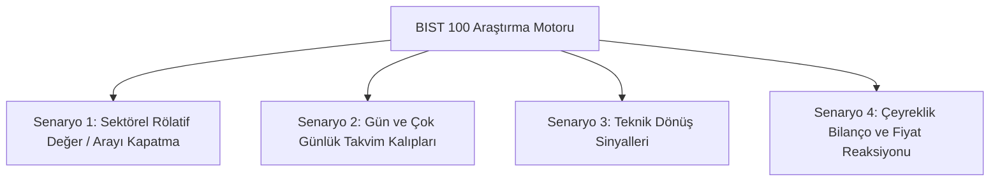

# CSE-481 MÜHENDİSLİK EKONOMİSİ DÖNEM PROJESİ
## BIST 100 Entegre Ajan Tabanlı Finansal Analiz ve Doğrulama Sistemi (Agentic Financial Analytics Harness)
### Kapsamlı Proje Rehberi, Kavramlar Sözlüğü, Teknoloji Yığını ve İki Kişilik Yol Haritası

---

## İÇİNDEKİLER
1. [Projenin Ana Amacı ve Felsefesi (Ne Yapıyoruz ve Neden Yapıyoruz?)](#1-projenin-ana-amaci-ve-felsefesi)
2. [Sıfırdan Başlayanlar İçin Finans ve Yapay Zeka Sözlüğü](#2-sifirdan-baslayanlar-icin-finans-ve-yapay-zeka-sozlugu)
3. [Hangi Teknoloji Nerede, Hangi Aşamada ve Nasıl Kullanılacak?](#3-hangi-teknoloji-nerede-hangi-asamada-ve-nasil-kullanilacak)
4. [Projenin 4 Temel Araştırma Senaryosu](#4-projenin-4-temel-arastirma-senaryosu)
5. [Ajan Mimarisi ve Harness Deneyleri (A'dan E'ye Sürümler)](#5-ajan-mimarisi-ve-harness-deneyleri)
6. [Nihai Çıktılar Neler Olacak? (Teslimat Listesi)](#6-nihai-ciktilar-neler-olacak)
7. [2 Kişilik İş Bölümü (Kim Ne Yapacak?)](#7-2-kisilik-is-bolumu)
8. [Detaylı Mikro Görev Listesi (Granular Task Checklist)](#8-detayli-mikro-gorev-listesi)
9. [İlk 3 Gün Eylem Planı (Nereden Başlayacağız?)](#9-ilk-3-gun-eylem-plani)
10. [Projeyi Ürünleştirme ve Ticarileştirme Vizyonu (FinTech SaaS & B2B)](#10-projeyi-urunlestirme-ve-ticarilestirme-vizyonu-fintech-saas--b2b)

---

## 1. PROJENİN ANA AMACI VE FELSEFESİ

### Büyük Resim: Yapay Zekanın Finanstaki Yanılsaması
Geleneksel olarak bir yapay zekaya (ChatGPT, Claude vb.) "THYAO hissesi sence haftaya yükselir mi, alayım mı?" diye sorduğunuzda model size son derece özgüvenli, akıcı fakat **istatistiksel olarak tamamen uydurma (halüsinasyon)** bir cevap verebilir. Arka planda matematiksel bir hesaplama yapmaz, gelecek verilerini bilmeden konuşur ve söylediklerinin geçmişte işe yarayıp yaramadığını denetlemez.

### Hocanın ve Projenin Çözüm Felsefesi
Bu projede amacımız "büyülü bir hisse tahmin yapay zekası" yapmak **değildir**. Amacımız; bir LLM'in (Büyük Dil Modeli) etrafına **"Harness" (Kafes/Kontrol İskelesi)** adı verilen sıkı bir yazılım mimarisi inşa etmektir.

Hocanın şartnamedeki altın kuralı:
> **"LLM reasons and explains. Python tools calculate. The harness controls. Backtests verify. Evidence is logged. A human makes the final decision."**
> *(LLM muhakeme eder ve açıklar. Python araçları hesaplar. Harness süreci yönetir. Backtest doğrular. Kanıtlar loglanır. Son kararı insan verir.)*

### Sistemin Karar Çıktısı Nedir?
Sistem kesinlikle doğrudan "AL" veya "SAT" diye kör bir emir üretmez. Bunun yerine şu tür **kanıta dayalı analitik durumlar** üretir:
* `POTENTIAL_CATCH_UP_CANDIDATE` (Sektörünün gerisinde kalmış ama temeli sağlam hisse adayı)
* `TECHNICAL_REVERSAL_CANDIDATE` (Aşırı satımdan Bollinger alt bandından dönen aday)
* `FUNDAMENTAL_IMPROVEMENT_CANDIDATE` (KAP bilanço açıklamasında net iyileşme gösteren aday)
* `WEEKDAY_PATTERN_NOT_STABLE` (Haftanın günleri etkisi istatistiksel olarak kalıcı değil)
* `ANALYSIS_UNSAFE` veya `INVESTIGATE` (Veri kalitesi yetersiz, gelecek sızıntısı riski var, işlem yapma)

---

## 2. SIFIRDAN BAŞLAYANLAR İÇİN FİNANS VE YAPAY ZEKA SÖZLÜĞÜ

Eğer finans veya ajan mimarilerine aşina değilseniz, raporda ve kodda sürekli geçecek terimler şunlardır:

### Finansal Terimler
* **BIST 100 & XU100**: Borsa İstanbul'un işlem hacmi ve piyasa değeri en yüksek 100 şirketinin endeksidir. XU100 piyasanın genel göstergesidir.
* **OHLCV**: Her işlem gününün 5 temel fiyat verisi: **O**pen (Açılış), **H**igh (En Yüksek), **L**ow (En Düşük), **C**lose (Kapanış), **V**olume (Hacim).
* **Teknik İndikatörler**:
  * **SMA / EMA**: Basit ve Üssel Hareketli Ortalamalar (Trend takibi).
  * **KAMA (Kaufman Adaptive Moving Average)**: Piyasanın gürültüsüne ve oynaklığına göre hassasiyetini kendisi ayarlayan uyarlanabilir ortalama.
  * **RSI (Göreceli Güç Endeksi)**: 0-100 arası salınır. 30 altı aşırı satım (ucuz kalmış/dönüş adayı), 70 üstü aşırı alım demektir.
  * **Bollinger Bantları**: Fiyatın oynaklığını standart sapmalarla çevreleyen üst, orta ve alt bantlar. Alt banda değip yukarı dönmesi alım sinyali olabilir.
  * **Supertrend**: Trendin yönünü (boğa/ayı) renkli bir çizgiyle belirleyen gösterge.
  * **Ichimoku Cloud (Ichimoku Bulutu)**: Destek, direnç ve trend yönünü gösteren çok bileşenli Japon göstergesi.
* **Look-Ahead Bias (Geleceğe Bakma Sızıntısı)**: Tarihsel bir test yaparken, $t$ anındaki kararı verirken henüz gerçekleşmemiş olan $t+1$ fiyatını veya henüz kamuya açıklanmamış bir bilançoyu kullanma hatasıdır. Bu hataya düşülürse model kağıt üzerinde mucizevi kârlar elde eder ama gerçek hayatta iflas eder.
* **Point-in-Time Veri**: Verinin şirketin dönem sonu tarihiyle değil, **kamuya açıklandığı gün ve saatle** sisteme girilmesidir. Örneğin: 2025 yılı 3. çeyrek bilançosu 30 Eylül'de biter ama KAP'a 5 Kasım akşamı düşer. Model bu veriyi 30 Eylül'de değil, ancak 6 Kasım sabahında bilmelidir!
* **TMS 29 (Enflasyon Muhasebesi)**: Türkiye'de yüksek enflasyon nedeniyle şirketler 2024'ten itibaren bilançolarını enflasyona göre düzelterek açıklamaya başladı. Eski nominal verilerle yeni veriler kıyaslanırsa elma ile armut toplanmış olur. Bu yüzden hocamız analiz dönemi olarak **1 Ocak 2025 – Kasım 2026** arasını önerdi.
* **Backtest (Geriye Dönük Test)**: "Eğer ben bu stratejiyi son 1,5 yıldır uygulasaydım ne kazanırdım/kaybederdim?" sorusunun simülasyonudur.
* **Sharpe Oranı**: Kazanılan getirinin alınan riske (oynaklığa) oranıdır. Ne kadar yüksekse o kadar iyidir.
* **Maximum Drawdown (Maksimum Değer Kaybı)**: Portföyün zirveden gördüğü en derin dip düşüş yüzdesidir (Risk ölçüsü).

### Yapay Zeka ve Ajan Terimleri
* **LLM (Large Language Model)**: Metin anlama ve üretme yeteneğine sahip dil modelleri (GPT-4o, Claude 3.5/Haiku, Qwen 2.5 vb.).
* **Agent (Yapay Zeka Ajanı)**: Sadece soruya cevap veren bir sohbet robotu değil; hedefi olan, elindeki araçları (tool) kullanan, adım adım kararlar alabilen otonom yazılım birimi.
* **Stateful Harness (Durumlu Kafes)**: Ajanın kafasına göre hareket etmesini engelleyen, adımları katı bir sıra ile (`START` $\to$ `VERİ_YÜKLE` $\to$ `KALİTE_KONTROL` $\to$ `HESAPLA` $\to$ `BACKTEST` $\to$ `İNSAN_ONAYI`) yürüten yazılım iskeleti.
* **MCP (Model Context Protocol)**: Yapay zekaya dışarıdaki fonksiyonları (Python'da hisse çeken, indikatör hesaplayan fonksiyonları) standart bir dille tanıtan ve çağırmasını sağlayan açık protokol.
* **Evidence Bundle (Kanıt Demeti)**: Modelin vardığı sonucu gerekçelendiren doğrulanmış veri seti (örn: "Hisse sektör medyanının %8 gerisinde, KAMA yukarı döndü, son çeyrek FAVÖK %20 arttı"). Model yalnızca bu kanıt havuzundaki verilere dayanarak konuşabilir!
* **Human-in-the-Loop (İnsanın Karar Döngüsünde Olması)**: Ajanın hazırladığı analizi insanın inceleyip "Onayla" veya "Reddet (Gerekçe: Drawdown çok yüksek)" diyebildiği kontrol adımı.

---

## 3. HANGİ TEKNOLOJİ NEREDE, HANGİ AŞAMADA VE NASIL KULLANILACAK?

| Teknoloji / Kütüphane | Hangi Aşamada Kullanılır? | Ne İşe Yarar / Nasıl Kullanılır? |
| :--- | :--- | :--- |
| **Python 3.10+** | Tüm Projede | Sistemin ana programlama dilidir. Bütün veri boru hatları, indikatörler ve ajan yapıları Python ile yazılır. |
| **Pandas & NumPy** | Veri İşleme & Finansal Hesaplama | Zaman serisi fiyat tablolarını yönetmek, getirileri hesaplamak, eksik verileri temizlemek ve matris işlemleri için. |
| **yfinance** | Veri Toplama Katmanı | 30 BIST hissesinin ve XU100 endeksinin geçmiş günlük OHLCV (Açılış-Yüksek-Düşük-Kapanış-Hacim) verilerini internetten çekmek için. |
| **pandas-ta** veya Saf Python Fonksiyonları | Teknik Analiz Katmanı | RSI, Bollinger Bantları, KAMA, Supertrend, Ichimoku Cloud formüllerini deterministik ve hatasız hesaplamak için. |
| **SQLite / Parquet / JSON** | Veri Tabanı ve Bellek (Memory) | İndirilen fiyatların, şirket finansallarının, ajan loglarının ve geçmiş kararların bilgisayarda kalıcı olarak saklanması için. |
| **FastMCP / Python MCP SDK** | Araç Entegrasyonu (MCP) | Python fonksiyonlarımızı (`get_stock_history`, `calculate_indicators` vb.) LLM'in resmi olarak anlayıp çağırabileceği MCP Tool formatına dönüştürmek için. |
| **LLM API** (Claude / OpenAI / Gemini / Ollama) | Akıl Yürütme Katmanı | Deterministik araçların ürettiği sonuçları yorumlamak, çelişkileri yakalamak ve insan için rapor yazmak amacıyla çağrılır. (Aynı model sabit tutulur). |
| **Matplotlib / Seaborn** | Raporlama ve Görselleştirme | Backtest kümülatif getiri grafikleri, drawdown eğrileri, sektör korelasyon matrisleri ve indikatör dönüş grafiklerini çizmek için. |
| **Jupyter Notebook** | Deney ve İnceleme | 4 araştırma senaryosunun testlerini adım adım çalıştırmak, tabloları ve grafikleri interaktif sunmak için. |

---

## 4. PROJENİN 4 TEMEL ARAŞTIRMA SENARYOSU

Projede kodlanacak ve analiz edilecek 4 zorunlu finansal araştırma konusu:



### Senaryo 1: Sektör Gerisinde Kalanlar (Sector Laggard / Catch-Up)
* **Hipotez**: Bir sektör genel olarak yükselirken (örneğin Bankacılık endeksi son 20 günde %12 yükselmiş), sektördeki hisselerin çoğu %15 artmışken bir hisse sadece %3 artmışsa, bu hisse sonradan arayı kapatır mı?
* **Yapılacak İş**: Hisseleri sektörlere ayır (`Banking`, `Airlines`, `Retail` vb.). Her hissenin sektör medyanına göre geride kalma skorunu (`lag_score`) hesapla. Geride kalanların sonraki 5, 10, 20 günde sektörü yakalayıp yakalamadığını backtest et. Temeli bozulduğu için mi geride kaldı (yapısal gerilik) yoksa geçici bir fırsat mı ayrımını yap.

### Senaryo 2: Gün ve Çok Günlük Takvim Kalıpları (Weekday & Multi-Day Patterns)
* **Hipotez**: "Pazartesi-Salı-Çarşamba düşüş trendi olan hisse Perşembe-Cuma toparlar" veya "Pazartesi sendromu / Cuma rallisi" gibi etkiler gerçek midir?
* **Yapılacak İş**: Her günün getiri dağılımlarını hesapla. Art arda 3 gün düşen hissenin sonraki 2 günlük tepkisini ölç. İşlem maliyetlerini (komisyon + kayma) düştükten sonra geriye kâr kalıyor mu ve bu kalıp test kümesi dışındaki dönemde (out-of-sample) devam ediyor mu sına.

### Senaryo 3: Teknik Dönüş Olayları (Technical Reversals)
* **Hipotez**: Bollinger alt bandına değen, RSI göstergesi 30'un altına inen ve KAMA eğimi yataylaşan bir hissede yukarı dönüş ihtimali nedir?
* **Yapılacak İş**: Bollinger, RSI, Supertrend, KAMA ve Ichimoku göstergeleri için "Olay Tespiti" (`Event Detection`) yap. Örneğin alt bant temaslarını bul. Sinyalden sonraki 1, 3, 5, 10 günlük getirileri çıkar. Tek başına Bollinger teması ile birleşik sinyallerin (Bollinger + RSI + Hacim) başarı oranını kıyasla.

### Senaryo 4: Çeyreklik Bilanço ve Fiyat Reaksiyonu (Post-Earnings Announcement Drift)
* **Hipotez**: Şirketin cirosu, FAVÖK marjı ve net kârı arttığında, hisse fiyatı bu veriye hemen mi tepki verir yoksa günlerce süren bir hareket mi başlar?
* **Yapılacak İş**: Şirket bilançosunun **KAP'ta yayınlandığı resmi tarihi** baz alarak, açıklanmayı takip eden 1, 5 ve 20 günlük anormal getirileri (XU100 endeksine ve sektörüne göre farkını) hesapla.

---

## 5. AJAN MİMARİSİ VE HARNESS DENEYLERİ

Hocanın şartnamede açıkça talep ettiği en can alıcı araştırma deneyleri **A'dan E'ye Sistem Kıyaslaması**dır:

```
[Sürüm A: Raw LLM] 
       ↓ (Araç ekleme)
[Sürüm B: LLM + MCP Tools] 
       ↓ (Katı Durum Akışı ekleme)
[Sürüm C: Tools + Stateful Harness] 
       ↓ (Veri Kalite Kapısı ve Kanıt Şartı)
[Sürüm D: C + Evidence Bundle + Quality Gate] 
       ↓ (Kalıcı Bellek ve İnsan Onayı)
[Sürüm E: D + Replayable Memory + Human Review]
```

* **Sürüm A (Raw LLM)**: LLM'e araç verilmez, metin olarak veri verilir ve yorum istenir. Modelin uydurma (halüsinasyon) oranı ölçülür.
* **Sürüm B (LLM + Tools)**: LLM'e Python indikatör fonksiyonları (MCP Tools) sunulur. Model bunları çağırarak hesap yapar.
* **Sürüm C (Tools + Stateful Harness)**: Ajan kafasına göre adımları atlayamaz. Önce veri kontrol edilmek zorundadır, sonra indikatör hesaplanır, ardından backtest koşulur.
* **Sürüm D (C + Evidence + Quality Gate)**: Veride gelecek sızıntısı (look-ahead) varsa veya eksik veri varsa sistem `HARD_BLOCK` veya `ANALYSIS_UNSAFE` vererek durur. Model sadece "Committed Evidence" listesindeki gerçek verilere dayanarak rapor yazabilir.
* **Sürüm E (Tam Sürüm)**: Bütün analiz geçmişi kaydedilir (`Replay`), insan inceleyicisine sunulur ve onay alınır.

---

## 6. NİHAİ ÇIKTILAR NELER OLACAK? (TESLİMAT LİSTESİ)

Dönem sonunda hocaya sunulacak ve teslim edilecek somut paket:

1. **Python Kaynak Kodları**:
   * Modüler, temiz, çalıştırılabilir Python dosyaları (`src/` altında).
   * Kurulum talimatları (`README.md`, `requirements.txt`).
2. **Sabitlenmiş 30 BIST 100 Evreni ve Veri Sözlüğü (Data Dictionary)**:
   * 30 hissenin sektör listesi, çekilen verilerin açıklamaları, sütun tanımları.
3. **4 Araştırma Raporu (Jupyter Notebook / Markdown)**:
   * Sektörel Catch-Up Araştırma Raporu.
   * Günlük/Takvim Kalıpları Araştırma Raporu.
   * Teknik Dönüş Olayları Raporu.
   * Bilanço Açıklama Reaksiyon Raporu.
4. **MCP Tool Tanımları ve Stateful Harness Motoru**:
   * Şartnamede geçen 14+ fonksiyonun MCP entegrasyonu.
   * Durum makinesi (`harness.py`).
5. **Backtest Sonuçları**:
   * Benchmark (XU100 ve Al-Tut) karşılaştırmalı getiri, Sharpe ve Drawdown tabloları.
6. **A–E Harness Deneyleri Karşılaştırma Raporu**:
   * 5 mimarinin halüsinasyon, hata ve güvenilirlik karşılaştırma tablosu.
7. **Nihai Teknik Rapor ve Sunum**:
   * Akademik standartlarda yazılmış proje raporu ve sunum slaytları.

---

## 7. 2 KİŞİLİK İŞ BÖLÜMÜ

Projede iki kişi olduğunuz için sorumlulukları temiz bir arayüzle bölüşmek işi çok kolaylaştıracaktır:

```
┌─────────────────────────────────────────┐   ┌─────────────────────────────────────────┐
│              KİŞİ 1                     │   │              KİŞİ 2                     │
│  [Finansal Veri & Nicel Analiz / Quant] │   │ [Ajan Sistemleri & Harness Mimarı / AI] │
├─────────────────────────────────────────┤   ├─────────────────────────────────────────┤
│ • 30 hisselik evrenin veri çekimi       │   │ • MCP Sunucusu ve Tool Şemaları         │
│ • OHLCV, BIST 100 ve Makro veri borusu  │   │ • Veri Kalite Kapısı (Look-ahead block) │
│ • Deterministik Teknik İndikatörler     │   │ • Stateful Harness Durum Makinesi       │
│ • 4 Araştırma Senaryosunun Hesaplaması  │   │ • Evidence Bundle & Memory/Replay       │
│ • Backtest Motoru (Sharpe, Drawdown)    │   │ • A-E Harness Kıyaslama Deneyleri       │
│ • Finansal rapor ve grafikler           │   │ • Ajan promptları ve İnsan Onay Arayüzü │
└─────────────────────────────────────────┘   └─────────────────────────────────────────┘
                    ▲                                              ▲
                    └────────── ORTAK ÇALIŞMA ALANI ───────────────┘
                               • Entegrasyon Testleri
                               • Final Teknik Raporu
                               • Sunum Hazırlığı
```

### Kişi 1 Sorumluluk Özeti:
* Verileri temin eder, temizler ve depolar.
* Matematiksel ve finansal kuralları (indikatörler, rasyolar, gün getirileri) Python fonksiyonu olarak yazar.
* Backtesting motorunu kurar ve stratejilerin geçmiş getirilerini hesaplar.
* Çıktısı: Kişi 2'nin çağırabileceği saf, hatasız Python fonksiyonları (`tools.py` ve `analytics.py`).

### Kişi 2 Sorumluluk Özeti:
* Kişi 1'in yazdığı fonksiyonları MCP araçlarına (`FastMCP`) bağlar.
* Sistemin durum makinesini (`Stateful Harness`) kurar; adımların sırayla çalışmasını denetler.
* LLM'in uydurmasını engelleyen Evidence Builder ve Quality Gate mekanizmasını yazar.
* A, B, C, D, E sürümlerini koşturup "Harness ne kadar hata önledi?" deneylerini yapar.
* Çıktısı: Ajan orkestrasyonu, deney karşılaştırma tabloları ve replay sistemi.

---

## 8. DETAYLI MİKRO GÖREV LİSTESİ

Projenin her bir adımı tik atabileceğiniz görevlere bölünmüştür:

### Faz 1: Altyapı ve Veri Boru Hattı (Data Pipeline)
- [ ] **Task 1.1**: Proje dizin yapısının (`src/`, `data/`, `notebooks/`, `reports/`) oluşturulması ve `requirements.txt` hazırlanması.
- [ ] **Task 1.2**: 30 BIST 100 hissesinin ve sektörlerinin (`universe.json` veya `universe.py`) tanımlanması.
- [ ] **Task 1.3**: `yfinance` ile 30 hissenin ve `XU100.IS` endeksinin 2024-2026 OHLCV verilerini indiren `get_stock_history()` fonksiyonunun yazılması.
- [ ] **Task 1.4**: İndirilen verilerin Parquet/CSV veya SQLite olarak yerel diskte saklanması.
- [ ] **Task 1.5**: TCMB/EVDS veya sentetik/örnek makro verilerin (USD/TRY, EUR/TRY, TCMB Faizi, TÜİK TÜFE) çekilmesi (`get_macro_context`).
- [ ] **Task 1.6**: Point-in-time bilanço verisi şablonunun oluşturulması (Fintables formatında ciro, FAVÖK, Net Kâr, Net Borç/FAVÖK ve resmi KAP açıklanma tarihi).

### Faz 2: Deterministik Teknik ve İstatistiksel Analiz Motoru
- [ ] **Task 2.1**: Teknik indikatör modülü (`calculate_indicators`): SMA, EMA, KAMA, RSI, MACD, Bollinger Bantları, ATR, Supertrend, Ichimoku Cloud hesaplayıcıları.
- [ ] **Task 2.2**: Destek ve Direnç tespit algoritması (`find_support_resistance`).
- [ ] **Task 2.3**: Senaryo 1 Motoru (`rank_sector_laggards`): Sektör medyan getirisi, geride kalma skoru (`lag_score`) ve hisse sıralaması.
- [ ] **Task 2.4**: Senaryo 2 Motoru (`test_weekday_pattern`): Gün bazlı getiri istatistikleri ve 3 gün düşüş sonrası toparlanma testleri.
- [ ] **Task 2.5**: Senaryo 3 Motoru (`detect_reversal_events`): Bollinger alt/orta/üst bant temasları ve RSI dönüş olaylarının zaman damgalı tespiti; 1, 3, 5, 10 günlük forward return ölçümü.
- [ ] **Task 2.6**: Senaryo 4 Motoru (`calculate_fundamental_change`): Çeyreklik büyüme, kârlılık değişimleri ve bilanço açıklanması sonrası kümülatif anormal getiri (CAR).

### Faz 3: Backtest ve Doğrulama Motoru
- [ ] **Task 3.1**: Sinyal kaydırma mekanizması (Look-ahead bias'ı önlemek için $t$ anında oluşan sinyalin $t+1$ açılış/kapanışında işleme girmesi).
- [ ] **Task 3.2**: İşlem komisyonu (örn: binde 1) ve slippage (kayma payı) parametrelerinin eklenmesi.
- [ ] **Task 3.3**: Finansal metrik hesaplayıcı: Kümülatif Getiri, Yıllıklandırılmış Getiri, Sharpe Oranı, Maksimum Değer Kaybı (Max Drawdown), Kazanma Oranı (Win Rate).
- [ ] **Task 3.4**: Benchmark karşılaştırması (Stratejinin XU100 ve Al-Tut getirisine göre alfa/fark hesabı).

### Faz 4: MCP Araçları ve Veri Kalite Kapısı (Data Quality Gate)
- [ ] **Task 4.1**: FastMCP veya standart Python fonksiyon wrapper'ı ile şartnamedeki 14+ fonksiyonun MCP Tool formatına dönüştürülmesi.
- [ ] **Task 4.2**: `check_data_quality()` kapısı:
  * Eksik veri veya bozuk fiyat serisi kontrolü.
  * Gelecek verisi sızıntısı kontrolü (Look-ahead bias denetimi).
  * Çıktı durumları: `PASS`, `PASS_WITH_WARNINGS`, `ANALYSIS_UNSAFE`, `HARD_BLOCK`.
- [ ] **Task 4.3**: Metinsel kanıt katmanı (KAP bildirimleri veya haber başlıklarının zaman damgalı filtrelenmesi).

### Faz 5: Stateful Agent Harness ve Replay
- [ ] **Task 5.1**: Durum makinesi (State Machine) tasarımı (`START` $\to$ `SELECT_UNIVERSE` $\to$ `LOAD_DATA` $\to$ `CHECK_DATA_QUALITY` $\to$ `CALCULATE_INDICATORS` $\to$ ... $\to$ `HUMAN_REVIEW` $\to$ `LOG_AND_CLOSE`).
- [ ] **Task 5.2**: Evidence Builder: Gözlemlenen 30+ özellik arasından sadece kararı doğrudan destekleyen maddelerin `Committed Evidence Set` (E1, E2, E3...) olarak seçilmesi.
- [ ] **Task 5.3**: Karar Loglama ve Replay (`log_decision` & `replay_analysis`): Analiz anındaki verilerin, çağrılan araçların, üretilen kanıtların JSON olarak kaydedilip istenildiğinde birebir yeniden oynatılabilmesi.
- [ ] **Task 5.4**: İnsan Onay Arayüzü (Konsol veya basit UI üzerinden ajanın önerisini kabul/reddet etme ve gerekçe yazma).

### Faz 6: A–E Harness Karşılaştırma Deneyleri
- [ ] **Task 6.1**: Aynı 10-20 soru/senaryo üzerinde 5 sistem sürümünün koşturulması:
  * Sürüm A: Raw LLM
  * Sürüm B: LLM + Tools
  * Sürüm C: Tools + Stateful Harness
  * Sürüm D: C + Evidence + Quality Gate
  * Sürüm E: D + Memory + Human Review
- [ ] **Task 6.2**: Metriklerin toplanması:
  * Sayısal Halüsinasyon Oranı (%)
  * Geçersiz Araç Çağrısı Oranı (%)
  * Desteksiz Sonuç Oranı (%)
  * Token / Maliyet ve Gecikme süreleri.
- [ ] **Task 6.3**: Deney sonuçlarının karşılaştırmalı grafik ve tablolarının üretilmesi.

### Faz 7: Raporlama ve Dokümantasyon
- [ ] **Task 7.1**: Data Dictionary ve 4 Araştırma Senaryosunun Raporlarının tamamlanması.
- [ ] **Task 7.2**: Final Teknik Raporunun yazılması (Giriş, Veri Mimarisi, Araştırma Bulguları, Harness Deney Sonuçları, Tartışma ve Kaynakça).
- [ ] **Task 7.3**: Kodların temizlenmesi, GitHub reposunun düzenlenmesi ve sunum slaytlarının hazırlanması.

---

## 9. İLK 3 GÜN EYLEM PLANI (NEREDEN BAŞLAYACAĞIZ?)

Hiç vakit kaybetmeden ve kafa karışıklığı yaşamadan şu sıra ile başlıyoruz:

### 1. Gün: Temel Kurulum ve Veri Çekimi (Kişi 1 & Kişi 2 Birlikte)
1. Proje ortamını (`venv`), klasör yapısını kurun.
2. 30 hisselik BIST evrenini `universe.py` dosyasına yazın.
3. `yfinance` ile bu 30 hissenin ve `XU100.IS` endeksinin son 2 yıllık günlük verisini çeken basit bir script yazıp verileri `data/` altına kaydedin.

### 2. Gün: Finansal Göstergeler ve İlk Senaryo (Kişi 1) + MCP İskeleti (Kişi 2)
* **Kişi 1**: Bollinger, RSI, KAMA, Supertrend fonksiyonlarını yazıp test etsin. İlk araştırma senaryosu olan "Sektör Gerisinde Kalanlar" (`rank_sector_laggards`) analizini koştursun.
* **Kişi 2**: MCP araç iskeletini ve Veri Kalite Kapısını (`check_data_quality`) yazmaya başlasın.

### 3. Gün: Basit Backtest ve Durum Makinesi
* **Kişi 1**: $t+1$ gecikmeli basit backtest simülasyonunu kodlasın.
* **Kişi 2**: Durum makinesini (`harness.py`) kurarak Kişi 1'in fonksiyonlarını adım adım zincirlesin.

---

## 10. PROJEYİ ÜRÜNLEŞTİRME VE TİCARİLEŞTİRME VİZYONU (FinTech SaaS & B2B)

Bu akademik projenin en büyük gücü, salt bir ödev olmanın ötesinde doğrudan pazarda satılabilir bir **FinTech Ürününe (SaaS)** dönüştürülebilir bir altyapıya sahip olmasıdır.

### 10.1. Pazar Problemi ve Değer Önerisi (Value Proposition)
* **Pazardaki Acı Nokta (Pain Point):** Bireysel ve kurumsal yatırımcılar yüzlerce sayfalık bilanço dipnotlarını, KAP bildirimlerini ve teknik grafikleri taramak için günde saatler harcamaktadır. Standart üretken yapay zekalar (ChatGPT, Claude vb.) ise finansal verilerde sayı uydurduğu (halüsinasyon) ve geriye dönük test yapamadığı için gerçek parada güven vermez.
* **Bizim Değer Önerimiz:** *"Borsa İstanbul için Kanıta Dayalı, Halüsinasyonsuz, %100 Denetlenebilir ve Tarihsel Test Edilmiş Finansal Araştırma Co-Pilot'u."*
* **Slogan:** *"Tahmin yok, dedikodu yok. Deterministik veri, zaman damgalı KAP kanıtı ve geriye dönük doğrulama var."*

---

### 10.2. Ürün Formatları ve Kullanım Senaryoları

#### 1. Web Terminali (B2C & B2B Araştırma Platformu)
* **Kullanıcı Arayüzü:** Modern, karanlık modlu (Bloomberg / TradingView estetiğinde) bir gösterge paneli (Dashboard).
* **Doğal Dil ile Arama:** Kullanıcı serbestçe sorar:
  > *"BIST 100'de son 1 ayda sektörünün gerisinde kalmış ama son çeyrek FAVÖK büyümesi pozitif olan şirketler hangileri?"*
* **Kanıt Çekmecesi (Evidence Drawer):**
  * Kullanıcı hisseye tıkladığında sistem tüm `Committed Evidence Set`i açar:
    * *Kanıt 1:* Sektör medyanının %8.2 gerisinde (Grafik ve hesaplama).
    * *Kanıt 2:* KAP Bilanço Bildirimi: 12 Şubat 18:32 (Net kâr marjı %14'ten %19'a çıktı).
    * *Kanıt 3:* Bollinger alt bant dönüşü teyit edildi.
  * **Geçmiş İstatistik:** *"Son 3 yılda bu kuralları sağlayan 18 vaka tespit edildi; 14'ünde 5 günlük getiri pozitif sonuçlandı (%77.7 başarı oranı, medyan getiri: +%5.2)."*
* **İnsan Onayı (Human-in-the-Loop):** Kullanıcı "Analizi Onayla ve İzleme Listeme Ekle" der.

#### 2. Akıllı Bildirim ve Sabah Bülteni Botu (Telegram / WhatsApp / E-Posta)
* Borsa seans kapanışından sonra (18:15) her akşam ve sabah açılış öncesi (09:30) çalışan otonom servis:
  * *"Bugün BIST 100'de teknik dönüş kurallarını sağlayan 2 hisse ve dün akşam açıklanan bilançosunda anormal pozitif sürpriz gösteren 1 hisse tespit edildi."*

#### 3. B2B White-Label & Araştırma Masası Entegrasyonu
* Aracı kurumların (İş Yatırım, Garanti BBVA Yatırım vb.) ve Portföy Yönetim Şirketlerinin analistleri için araştırma raporu taslaklama motoru.
* Analistin 3 saatte hazırladığı günlük bülteni veya hisse analiz notunu 30 saniyede hazır, kaynaklı ve grafikli bir taslak olarak analistin önüne koyar.

---

### 10.3. Gelir ve Fiyatlandırma Modelleri (Monetization)

1. **B2C Freemium SaaS Modeli:**
   * **Ücretsiz Katman (Free):** Günde 2 hisse analizi, gecikmeli veriler, temel indikatör özeti.
   * **Pro Katman (Örn: 299 – 499 TL/ay):** Tüm BIST 100 evreni, anlık 4 senaryo motoru, sınırsız backtest sorgusu, Telegram alarm botu.
   * **Quant Katman (Örn: 999 TL/ay):** Kendi özel kural setini yazabilme, API erişimi ve Excel/CSV veri dışa aktarma.
2. **B2B Kurumsal Lisanslama:**
   * Finans kurumlarına analist başına aylık lisans veya aracı kurumun kendi mobil uygulamasına entegre "Akıllı Borsa Asistanı" API'si (aylık 2.000$ – 10.000$ seviyesi).

---

### 10.4. Yasal ve Regülasyon Kalkanı (SPK Uyumluluğu)
Sermaye Piyasası Kurulu (SPK) mevzuatına göre kişiye özel doğrudan "AL" veya "SAT" demek portföy yöneticiliği veya yatırım danışmanlığı lisansı gerektirir.
* Bu ürünün en büyük yasal avantajı: **Sistem "AL/SAT" demez; analitik durum ve tarihsel istatistik sunar.**
* Sistem: *"Bu hisse tarihsel olarak şu 3 kriteri sağladığında geçmişte %72 ihtimalle şu yönde hareket etmiştir"* der.
* Bu yapı, ürünü yasal olarak doğrudan bir **"Veri ve Karar Destek Aracı"** (Matriks, Foreks veya TradingView gibi) statüsüne sokarak regülasyon riskini bertaraf eder.

---

### 10.5. Projeden Girişime (Start-up) 3 Adımlı Yol Haritası

```
[Aşama 1: Üniversite Projesi (Şu Anki Durum)]
└─ Python çekirdek motoru, 4 senaryo, MCP araçları, harness deneyleri ve akademik rapor.
        ↓
[Aşama 2: Çalışan MVP (Proje Bitimi Sonrası 3-4 Hafta)]
└─ Streamlit veya FastAPI + Next.js arayüzü, görselleştirme dashboard'u, demo video.
        ↓
[Aşama 3: Beta Lansmanı ve Ticarileşme]
└─ BIST lisanslı veri beslemesi, ilk 100 beta kullanıcısı (üniversite finans kulüpleri & borsa toplulukları), TÜBİTAK BİGG / KOSGEB hibe başvuruları.
```

---
*Bu doküman, projeyi baştan sona eksiksiz tamamlamanız ve geleceğe taşımak isterseniz bir girişim haline getirmeniz için hazırlanmıştır.*
